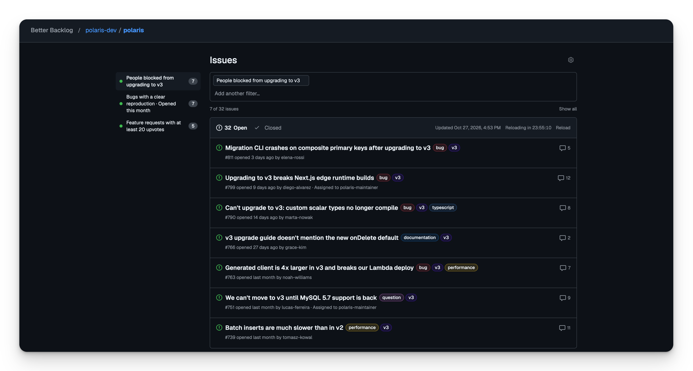

# Better Backlog

Filter GitHub issues in your own words with decision models.



## Set up with your agent

Paste this into Claude Code, Codex, or any coding agent:

```text
Set up Better Backlog for me locally from https://github.com/BerriAI/better-backlog
1. Clone it into ~/better-backlog, or pull if it is already there. It needs Node 22 or newer and no npm install.
2. Check that the GitHub CLI is logged in with `gh auth status`. If it is not, ask me to run `gh auth login`.
3. Ask me which GitHub repository to filter, as owner/name.
4. Start it in the background with `BETTER_BACKLOG_REPO=<owner/name> npm start` and open http://127.0.0.1:4317.
5. Ask me to paste my TypeSafe API key, or my gateway URL and key, into Settings on that page. Never ask for the key in chat.
6. Confirm the issues load. When I ask you to filter issues, use `node cli.mjs filter "<criterion>" --json` from the repo; `node cli.mjs --help` lists everything else.
```

## Set up yourself

```sh
git clone https://github.com/BerriAI/better-backlog
cd better-backlog
npm start
```

Open [127.0.0.1:4317](http://127.0.0.1:4317). Better Backlog reads GitHub issues using your existing GitHub CLI login. If you need to sign in:

```sh
gh auth login
```

Choose a repository and paste your TypeSafe key in **Settings**. Save, type a criterion, and press **Enter**. Add another to narrow the list.

Prefer a gateway? Choose it in Settings, enter its URL and key, and select a decision model.

Issues reload every 24 hours, with a live countdown. Change the interval in Settings. **Reload** fetches fresh issues and resets the countdown.

Filter results are cached until the next reload. Recent filters sit on the left: a solid dot is fresh and opens instantly; a hollow dot reruns against the new issues.

Keys are saved in `.env` and issue downloads in `.local/`, both gitignored.

## Command line

```sh
node cli.mjs filter "people asking for new providers" "opened this month"
node cli.mjs recent
node cli.mjs forget "people asking for new providers" "opened this month"
node cli.mjs issues --state closed
node cli.mjs reload
```

Add `--json` for machine-readable output and `--repo owner/name` to pick a repository. The CLI uses the running app when it is open, so both share one cache and one list of recent filters.

## Credits

Icons from [Octicons](https://github.com/primer/octicons) by GitHub, MIT licensed; see [NOTICE](NOTICE). Font: [Geist](https://vercel.com/font), SIL Open Font License.

[MIT](LICENSE)
